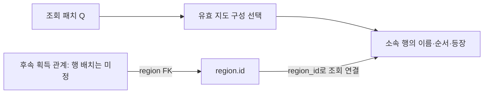

# 후속 자료의 지역 참조안

Task 001의 지도 구조와 Task 003/004의 획득·동일 패치 조회를 연결하는 C-A 참조 계약이다. 획득 본행의 표/키·수량·유효 구간 저장 표현은 003/004가 맡으며 실제 자료·SQL·테이블을 만들지 않는다.

## 기존 합의

- 지역 ID는 시즌 사이 유지한다. R-A는 패치별 지도 전체 구성 버전과 소속 행을 보존한다.
- 후속 관계는 같은 조회 패치의 정보를 사용한다. A-A의 소속 행 DELETE는 지정 구성의 교정에 한정한다.
- 재료/스킬의 특정 버전 직접 참조와 아이템 중심 귀속 계약은 그대로 유지한다.

## C-A — 지속 지역 참조와 패치별 소속 검사

지역을 갖는 후속 획득 관계의 지역 참조는 region.id FK로 두고 지도 소속 행 id나 복합 키는 FK로 참조하지 않는다. 지도 버전 ID도 획득 관계에 별도 고정하지 않는다. 조회 패치 Q에서 유효한 지도 버전을 한 번 선택하고 region_id로 소속 행을 연결한다.

지도 이름/순서 정정과 소속 행 재작성 때문에 획득 FK가 끊기지 않고, 표시 변경만으로 획득 관계를 복제하지 않기 위한 계약이다. FK는 지속 대상의 존재만 보장하며 해당 패치의 실제 등장까지 보장하지 않는다.

region.display_name은 작업 편의용 내부 이름이다. 공개 획득 조회의 지역 이름은 같은 Q의 지도 소속 행에서 읽고 작업용 이름을 대체값으로 사용하지 않는다. 작업용 이름 변경은 지역 등장 검사·획득 FK·지도 이력을 바꾸지 않는다.

## 비교 대안 C-B — 지도 소속 행 직접 FK

후속 관계가 region_map_member.id 또는 (map_version_id, region_id)를 직접 참조한다. DB가 특정 구성에 속한 행의 존재를 검사할 수 있다. 다만 조회 패치에 그 구성이 유효한지는 여전히 검사해야 한다. 새 지도 구성 이후에도 참조가 해당 Q의 유효 구성과 맞는지 대조하고 필요하면 참조 재지정/새 관계 구성을 준비해야 한다. 소속 행 삭제/재작성 교정은 참조 중 제한되므로 행/키를 보존하는 교정 수단도 다시 설계해야 한다.

## C-A에서 지킬 검사와 동시성

다음은 실제 게임 자료가 아닌 경합 예다. 획득 작업이 Q에서 R의 등장을 확인한 뒤, 지도 작업이 Q 이전부터 R이 빠지는 새 구성을 저장하고, 그 뒤 획득 작업이 저장되면 region FK 자체는 유효해도 Q의 소속이 틀릴 수 있다. L-A는 이 두 관련 쓰기의 순서를 맞추고 뒤의 작업이 최신 결과를 다시 검사하게 한다. 기존 지도 행 잠금만으로 새 구성 추가를 막았다고 가정하지 않는다.

| 시점                          | 검사 범위·실패 처리                                                                                                                 |
| ----------------------------- | ----------------------------------------------------------------------------------------------------------------------------------- |
| 획득 관계 등록/수정           | 관계의 유효 구간과 겹치는 지도 변경 경계에서 해당 지역의 등장을 확인. 미확인 지도/미등장을 정상 참조로 수용하지 않음                |
| 지도 추가/교정·시작 패치 변경 | 영향 구간의 기존 획득 관계·관련 원본/캐시를 대조. 불일치는 자동 누락/삭제로 숨기지 않고 업무 롤백 또는 명시된 관련 변경과 함께 처리 |
| 시즌/패치 정렬 교정           | 지도 적용 구간과 관계 유효 구간의 순서가 바뀌는 영향을 같은 업무로 검증                                                             |

관계 유효 구간의 정확한 시작/끝은 003/004 계약을 입력으로 받는다. 지역이 등장하지만 특정 아이템을 획득할 수 있는지는 별도 획득 사실이며 자동 생성하지 않는다. 검사할 후속 관계가 존재하는데 검증 경로가 준비되지 않았다면 검사를 생략해 성공으로 보고하지 않는다.

기존 지도 부모 행만 잠그면 새 지도 구성의 동시 INSERT까지 막지 못한다. 획득 쓰기의 소속 검사·관계 유효 구간 변경과 지도/패치 순서 변경은 [L-A 국소 잠금 프로토콜](writes-and-checks.md#catalog-locking)에 함께 참여한다. 일반 공개 조회에 이 잠금을 요구하지 않는다.

## 담당과 필요한 확인

001이 참조 방향·지도 적용 범위·공통 잠금안을 준비하고, 003은 획득 본행/유효 구간·region FK의 실제 배치를, 004는 동일 Q의 결합 조회·수정/실패 일치를 담당한다. #45의 실제 획득/지역 사실은 보류 해제 뒤 확인한다.

C-A 참조 원칙은 다시 선택하지 않는다. 후속 표의 전체 키·수량·API 승인이나 실제 테이블 생성 승인으로 확대하지 않는다. 실제 생성 직전에는 [전체 구조 재확인](../migration/README.md#precreation-confirmation)을 받는다.
