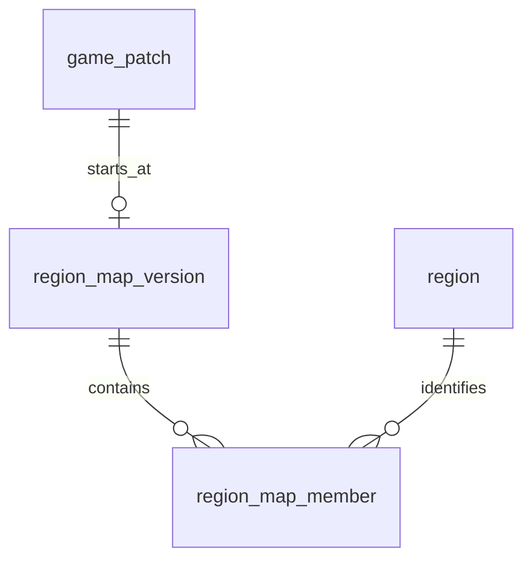

# 지역의 지도 구성·이력 배치안

지속 지역 ID·게임 패치 이력과 지도 전체 구성 버전/소속 행의 총 8개 표 및 아래 열·키·참조/교정 수단은 사용자 확인을 받은 저장 계약이다. region의 작업용 표시 이름은 [공통 표](table-layout.md#region)에 두고 공개 이름·순서와 구별한다. 실제 자료·DB 작업과 구현 파일 생성은 보류한다.

## R-A — 지도 전체의 구성 버전

공통 region 외에 region_map_version·region_map_member를 추가하는 총 8개 표 안이다. 지역 구성이 바뀌는 패치에 전체 등장 지역의 이름·순서를 한 구성으로 보존한다. 변화가 없는 패치는 앞선 구성을 사용하며 매 패치 복사하지 않는다.

조회 우선 요구에 맞춰 지도 버전을 한 번 고르고 소속 행을 읽는다. 같은 지도 안 이름/순서의 중복을 UNIQUE로 표현하기 쉽고, 미확인 지도와 확인된 빈 지도를 구별하기 위한 구조다. 한 지역만 바뀌어도 새 구성의 소속 행 전체를 준비하는 비용이 있다.

## region_map_version

| 열                 | 자료형                 | NULL | 검사·역할                                        |
| ------------------ | ---------------------- | ---- | ------------------------------------------------ |
| id                 | BIGINT IDENTITY ALWAYS | 불가 | PK                                               |
| from_game_patch_id | BIGINT                 | 불가 | game_patch.id FK + UNIQUE. 구성의 적용 시작 패치 |

## region_map_member

| 열             | 자료형                 | NULL | 검사·역할                                 |
| -------------- | ---------------------- | ---- | ----------------------------------------- |
| id             | BIGINT IDENTITY ALWAYS | 불가 | PK                                        |
| map_version_id | BIGINT                 | 불가 | region_map_version.id FK                  |
| region_id      | BIGINT                 | 불가 | region.id FK. 시즌 사이 같은 대상 ID 유지 |
| name           | TEXT                   | 불가 | 이 지도 구성의 지역 이름. 빈값 금지       |
| sort_order     | BIGINT                 | 불가 | 10 이상·10의 배수                         |

소속 행은 `(map_version_id, region_id)`, `(map_version_id, name)`, `(map_version_id, sort_order)` 각각 UNIQUE다. name에는 N2의 COLLATE "C"를 명시한다. 다른 지도 구성에서 같은 이름/순서를 재사용할 수 있다. FK는 비지연/삭제 RESTRICT와 ON UPDATE NO ACTION을 적용한다. 새 두 표의 ID/PK는 M-A에 따라 [8개 표의 공용 guard](permissions-and-installation.md#current)로 보호하며 실제 설치는 생성 승인 뒤다.

## 조회 의미

1. 조회 패치의 sort_order 이하에서 from_game_patch의 sort_order가 가장 큰 지도 구성을 선택한다. ID·날짜·등록 순서로 대신 고르지 않는다.
2. 선택한 구성의 소속 행 전체를 읽는다. 적용 범위는 시작 패치 이상·다음 구성 시작 패치 미만이며 별도 종료 패치 열은 두지 않는다.
3. 앞선 구성이 없으면 지도 정보 미확인이다. 구성 행이 있고 소속 행이 0개면 확인된 빈 지도다. 빈 구성을 자동 생성해 미확인을 숨기지 않는다.
4. 완전한 구성에서 빠진 지역은 그 구성에서 등장하지 않는다. 다음 구성에 빠졌다고 과거 구성의 소속 행을 삭제하지 않는다.

공개 지역 이름/순서는 선택한 구성의 소속 행에 필수로 존재한다. region.display_name은 작업용이며 공개 조회의 대체값으로 사용하지 않는다. 작업용 이름 수정은 지도 구성의 이름·등장·순서를 변경하지 않는다. applied_at 미확인과 지도 구성의 패치 순서 조회를 혼용하지 않는다.

## 비교 대안 R-B — 지역별 변경 이력

region에 지역별 from_patch·이름·순서·등장 여부를 저장하는 이력 표 하나를 추가하는 총 7개 표 안이다. 지역 하나 변경 시 그 지역의 행만 늘려 원본/정정 단위가 작다. 조회에서는 지역별 유효 행을 조합해야 하며 같은 조회 패치의 이름/순서 중복은 단순 이력 행 UNIQUE만으로 보장할 수 없어 기간별 서비스 검사·동시성 수단이 더 필요하다.

## 참조·교정에서 확인할 것

R-A에서는 지정 패치의 완전한 지도 구성을 한 업무로 입력한다. 새 게임 변경은 새 구성으로, 같은 구성의 오입력은 명시된 교정 범위로 다룬다. 적용 범위는 다음 독립 구성 전까지이며 다른 완전한 구성을 자동 덮어쓰지 않는다.

획득 관계의 지역 참조는 [C-A 계약](consumer-references.md#current)에 따라 지속 region.id FK로 두고 소속 행 자체(행 id/복합 키)는 직접 참조하지 않는다. 같은 Q의 소속 검사는 서비스가 맡고 지도 교정의 영향 구간을 후속 관계와 함께 검증한다. 후속 표의 정확한 배치/유효 구간은 Task 003/004가 담당한다. 새 소비자가 직접 소속 행 FK를 요구하면 기존 교정 방식과의 충돌부터 다시 검토한다.

실제 생성 직전에는 채택한 R-A의 전체 열·PK/FK·NULL·유일성과 조회/교정 예를 다시 보여주고 [사용자 확인](../migration/README.md#precreation-confirmation)을 받는다.
