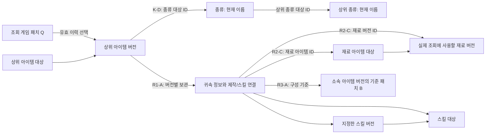

# Task 43-001 — 공유 버전·참조 관계

아이템·스킬·재료의 버전 보관과 조회 의미, 현재 분류 예외를 읽을 때. 담당 상태·수용 판단은 [Task 43-001](../task-001.md#summary), 전체 길잡이는 [설계 안내](task-001-shared-version-references.md#summary)를 따른다. 아래 채택·비채택·미정을 구별하며 실제 자료·DB 작업과 구현 파일 생성은 계속 보류한다.

공유 관계의 확정 규칙은 R1/R2/R3/K-D를 따른다. 공통 저장·갱신 규칙은 각 담당 상세에서 확인한다.

## 유효한 합의 — 유지할 기준

| 주제                | 유지할 내용                                                                                                                                                                                                                                                                                                                                                                                                                                                               | 근거                                                                                                                                                                                        |
| ------------------- | ------------------------------------------------------------------------------------------------------------------------------------------------------------------------------------------------------------------------------------------------------------------------------------------------------------------------------------------------------------------------------------------------------------------------------------------------------------------------- | ------------------------------------------------------------------------------------------------------------------------------------------------------------------------------------------- |
| 대상과 버전의 구별  | 지속적인 아이템/스킬 대상과 특정 버전을 구별한다. 내부 ID는 지정한 시즌 번호·패치 표기/정렬값·지역 정렬값과 별개다. ID의 BIGINT/Long/문자열 전달 기준도 유지한다.                                                                                                                                                                                                                                                                                                         | [공통 ID](<../../../../../docs/details/development/공통 DB 모델.md#internal-identifiers>) · [제품 식별](../../../../../docs/details/product/게임 데이터 변경 관리.md#identity-information)  |
| 시즌·게임 패치      | 시즌 번호/이름/기간과 게임 패치의 시즌·메이저/마이너·별도 이름·정렬값·적용 일시를 구별한다. 기존 정렬식·날짜/UTC 초 단위 기준을 유지하고 실제 범위·미확인 허용을 가정하지 않는다.                                                                                                                                                                                                                                                                                         | [시즌·패치](../../../../../docs/details/product/게임 데이터 변경 관리.md#season-information) · [일시](../../../../../docs/개발 기준.md#datetime)                                            |
| 아이템 중심 보존    | 귀속 정보의 구성이 바뀌면 새 아이템 버전으로 당시 구성을 보존한다. 변경된 패치에만 새 정보를 등록하고 다음 변경 전까지 사용하며, 이력에서 조회 패치에 유효한 정보를 선택한다. 별도의 최신 원본 사본은 두지 않는다.                                                                                                                                                                                                                                                        | [아이템 중심 버전](../../../../../docs/details/product/게임 데이터 변경 관리.md#version-applicability)                                                                                      |
| 종류·등급·무기 종류 | K-D로 종류 이름·상하위 관계에는 버전을 두지 않고 과거 조회에도 현재 기준을 적용한다. 아이템 자체의 소속 종류 ID 변경은 아이템 버전으로 보존한다. 등급은 별도 이름/순서 정보이며 관리자가 원자료를 보고 수정 이유를 판단하고 기본 입력/DB 검사를 적용한다. 같은 대상의 오입력은 같은 ID에서 고친다. 무기 종류는 별도 대상으로 초기부터 두고 종류 계층과 연결한다. F2-A·F2-B의 종류 부모/아이템 소속 개수는 채택했으며 별도 무기 종류 대응 등 그 밖의 관계 개수는 미정이다. | [분류](../../../../../docs/details/product/아이템 탐색과 상세.md#classification)                                                                                                            |
| 능력치              | 같은 아이템 버전에 같은 종류를 중복 등록하지 않는다. `item_stat`을 원본, `stat_json`을 그 버전의 표시 캐시로 두고 값을 일치시킨다. NUMERIC/BigDecimal·백분율 표현을 유지한다.                                                                                                                                                                                                                                                                                             | [원본·캐시](../../../../../docs/details/product/아이템 탐색과 상세.md#stat-information) · [수치](../../../../../docs/개발 기준.md#stat-numeric)                                             |
| 스킬 연결           | 한 아이템에 여러 스킬을 연결할 수 있다. 연결은 스킬 대상·특정 스킬 버전·게임 패치를 직접 참조하며 대상/버전의 소속이 일치해야 한다. 이름·설명은 지정한 스킬 버전, JSON은 연결에 둔다.                                                                                                                                                                                                                                                                                     | [스킬 대상·버전·연결](../../../../../docs/details/product/게임 데이터 변경 관리.md#item-skills)                                                                                             |
| 제작·획득·배달      | 같은 버전의 대체 조합법은 없고 두 재료를 각 1개 소비하며 생산 수량은 별도다. 복수 획득 방법/지역, 획득·배달당 공통 수량, 지역 총 출현 개수를 구별해 보존한다. 사냥 대상은 별도로 관리하는 방향이다.                                                                                                                                                                                                                                                                       | [제작](../../../../../docs/details/product/아이템 탐색과 상세.md#recipes) · [획득·수량](../../../../../docs/details/product/아이템 탐색과 상세.md#acquisition-methods)                      |
| 상태·정정           | 게임 내 삭제와 검색 제외는 별개이며 삭제 전 정보와 필요한 조합 참조를 보존한다. 입력 오류 정정을 새 게임 패치로 꾸미지 않는다.                                                                                                                                                                                                                                                                                                                                            | [노출·삭제](../../../../../docs/details/product/아이템 탐색과 상세.md#preview-and-detail) · [변경·정정](../../../../../docs/details/product/게임 데이터 변경 관리.md#change-and-correction) |
| P1 경계             | 스킬은 저장·설명 텍스트 표시 지원까지다. 수식 실행·정보별 독립 관리 완성·버전 선택기·전용 관리 화면을 선행 조건으로 추가하지 않는다.                                                                                                                                                                                                                                                                                                                                      | [Phase 범위](../../phase.md#agreed-data-scope) · [DB Issue 수용 조건](../issue.md#acceptance)                                                                                               |

## 공유 관계의 읽는 기준

종류 이름·상하위 관계는 K-D의 채택으로 버전 관리에서 제외했다. 현재 분류를 사용하는 이 예외와, 아이템 자체의 소속 종류 ID를 아이템 버전으로 보존하는 요구를 구별한다. 나머지 채택 결정은 유지한다.

조회할 게임 패치를 Q라고 부른다. Q와 각 정보가 마지막으로 변경된 패치는 구별해야 한다. 예를 들어 아이템의 마지막 변경이 P0이고 Q까지 바뀌지 않았다면 Q 조회에서도 그 아이템 버전을 사용한다. 같은 Q의 정보를 읽는다는 이유로 모든 행의 변경 패치 ID를 같게 만들지는 않는다.

| 관계                                               | 이미 정해진 역할                                                                                                          | 아직 정해야 할 부분                                                                                                |
| -------------------------------------------------- | ------------------------------------------------------------------------------------------------------------------------- | ------------------------------------------------------------------------------------------------------------------ |
| 시즌 → 게임 패치, 지역/분류의 공통 식별            | 시즌·패치와 지역 정렬값 등의 의미를 구별하고 다른 Task의 공통 참조 기반으로 사용                                          | 실제 키·유일성·지역의 시즌 연결/변경 범위와 허용 값                                                                |
| 아이템 대상 → 아이템 버전 → 귀속 구성              | 대상의 정체성과 특정 패치부터 유효한 구성, 능력치 원본/캐시와 제작/획득/배달을 구별                                       | R1-A 보관 기준은 채택. 실제 행 배치·키·정정 수단은 미정                                                            |
| 아이템/제작 재료 → 참조 대상                       | 관련 정보를 같은 조회 기준에서 일치시키고 과거 관계를 보존                                                                | 재료는 두 ID 직접 참조·저장 버전 조회·상위 새 버전 준비를 채택. 종류는 K-D로 대상 ID만 참조. 구체 검사 수단은 미정 |
| 아이템의 스킬 연결 → 스킬 대상·지정 버전·게임 패치 | 지정한 버전의 이름·텍스트와 연결별 JSON 사용. R3-A로 연결 패치는 소속 아이템 버전 기준이며 독립 연결 버전은 분리하지 않음 | 대상/버전 소속과 소속 아이템 버전 기준 패치의 구체 키·검사 수단은 후속 물리 설계                                   |
| 종류 계층 ↔ 별도 무기 종류                         | 캐릭터/무기 스킬의 후속 연결을 위한 별도 대상과 종류 계층을 함께 유지                                                     | 대응 목록·관계의 개수 제한·변경 보존 방식은 필요한 입력과 사용자 선택 후 결정                                      |
| 제작/획득 관계 → 재료 아이템·지역·사냥 대상        | 원자료의 수량·방법·관계를 보존하고 검색 제외만으로 필요한 관계를 지우지 않음                                              | 기본 재료/누락 구별의 저장 표현, 사냥/임시 관계의 실제 필드와 범위                                                 |

스킬 연결은 특정 버전 직접 참조가 이미 합의돼 있다. 따라서 R2의 일반 참조 대안을 스킬에 일괄 적용해 임의의 최신 스킬 버전으로 교체하지 않는다. 실제 어느 아이템이 새 스킬 버전을 사용해야 하는지는 자료 작업 재개 뒤 확인할 내용이다.

## R1 — 아이템 버전의 귀속 구성을 어떻게 보관할까

결론: 아이템 버전마다 귀속 행을 별도로 보관한다(R1-A). 공유 모델은 001, 구체 저장 설계는 [002](../task-002.md#decisions)·[003](../task-003.md#decisions)이 담당한다. 실제 DDL/코드 구현은 미착수다.

| 대안                                              | 작동 방식                                                                                                                                                          | 장점                                                                                         | 부담·영향                                                                                                                 |
| ------------------------------------------------- | ------------------------------------------------------------------------------------------------------------------------------------------------------------------ | -------------------------------------------------------------------------------------------- | ------------------------------------------------------------------------------------------------------------------------- |
| A. 버전마다 귀속 행을 보관 — 채택                 | 새 아이템 버전을 만들면 그 버전이 사용할 기본 정보·능력치·제작/획득/배달·스킬 연결 구성을 해당 버전에 속하게 보관한다. 변경하지 않은 귀속 행도 새 구성에 보관한다. | 한 버전의 구성과 수정 범위를 추적하기 쉽다. 공유 행 수정이 다른 버전에 번지는 문제를 줄인다. | 바뀌지 않은 정보도 버전별 저장량이 늘어난다. 어떤 행을 새 구성에 보존할지 누락 없이 검증해야 한다.                        |
| B. 변경하지 않은 정보 묶음을 공유 — 비채택 비교안 | 새 아이템 버전이 기존의 변경 불가 정보 묶음을 재사용하고, 바뀐 부분의 새 묶음만 참조한다.                                                                          | 반복 저장을 줄일 수 있다. 아이템 중심으로 구성 선택을 유지할 수 있다.                        | 공유 묶음·소유 관계·참조를 더 관리해야 한다. 정정 시 공유 묶음을 바꿀지 새 묶음을 만들지와 영향받는 버전을 확인해야 한다. |

추천 이유는 P1에서 구성의 완전성·정정 영향·원본/캐시 일치를 확인하기 쉬운 쪽을 먼저 택하려는 것이다. 실제 저장 규모나 성능을 측정한 결론은 아니다. B도 아이템 버전이 구성을 선택하도록 만들 수 있으므로, 이를 정보별 독립 버전 관리로 자동 해석하지 않는다.

A의 보관 범위는 아이템 귀속 값과 직접 연결이다. 참조하는 종류·재료 아이템·스킬 정의 전체까지 매번 복제한다는 뜻은 아니다. 참조 대상의 읽는 방식은 R2와 기존 스킬 직접 참조를 따른다. 이력 안의 버전별 구성 보관은 금지한 별도 최신 원본 사본과도 구별한다.

실제 행 배치·키·저장/수정 수단은 관련 Task의 구현 전에 확인한다. 실제 자료·DB·구현 작업은 보류한다.

## R2 — 종류·상위 종류·제작 재료의 참조를 어떻게 고정할까

결론: 재료 대상 ID와 버전 ID를 함께 저장하고 저장된 버전으로 조회하며, 영향받는 상위 구성에는 새 버전을 준비한다. 종류는 버전 없이 현재 이름·상하위 관계를 적용하고 아이템 버전은 종류 대상 ID만 참조한다. 001과 각 저장 Task가 설계하고 004가 결합 조회를 검증한다. 구체 키·제약·갱신/생성 수단은 담당 미정이다. 스킬의 특정 버전 직접 참조와 등급의 별도 정보 구분도 유지한다.

| 대안                                 | 작동 방식                                                                              | 장점                                                                                                                  | 부담·영향                                                                                                                                                           |
| ------------------------------------ | -------------------------------------------------------------------------------------- | --------------------------------------------------------------------------------------------------------------------- | ------------------------------------------------------------------------------------------------------------------------------------------------------------------- |
| A. 대상 ID 참조 + Q의 유효 버전 조회 | 재료 관계에는 지속 아이템 대상을 연결하고 조회 Q에서 그 대상의 유효한 버전을 선택한다. | 재료 자체만 바뀌었을 때 주변의 아이템 관계를 다시 만들 필요를 줄인다. 각 대상의 이력과 같은 Q의 조회를 함께 유지한다. | 조회할 때 버전 선택이 필요하다. Q에서 유효한 대상 정보가 없을 때의 처리와 참조 일치를 검증해야 한다.                                                                |
| B. 특정 재료 버전 직접 참조          | 구성에 참조할 특정 버전 ID를 저장한다.                                                 | 구성에서 어떤 버전을 지정했는지 직접 확인할 수 있다.                                                                  | 같은 Q에서 바뀐 재료 정보를 반영하려면 그 참조를 가진 구성의 연쇄 갱신이 필요할 수 있다. 이를 하지 않고 오래된 버전을 사용하면 Q의 유효 정보 요구와 충돌할 수 있다. |

사용자 조건에 따라 생성 복잡도보다 조회 경로를 우선해 비교한다. 재료의 대상/버전을 함께 참조하는 C안은 대상 식별과 특정 버전 접근을 함께 제공하는 후보이며, 생성 시 영향 관계를 준비하는 비용만으로 배제하지 않는다. 실제 조회 성능의 우열은 아직 측정하지 않았다. 종류 이름·상하위 관계는 확정한 K-D에 따라 버전 없이 현재 기준을 사용하므로 이 버전 참조 비교를 적용하지 않는다. 위 A·B는 재료의 초기 비교안이며 실제 확정한 두 ID 참조는 아래 C-고정이다.

예시: P0의 조합이 재료 M을 사용하고 P1에 M의 정보만 바뀐다. Q=P1 조회에서 A는 같은 재료 대상 M의 P1 유효 정보를 선택한다. B는 지정 버전을 바꾸는 처리가 필요하다. 어떤 안이든 Q 이전 이력이 없는 대상을 미래 버전으로 채우거나, 검색 제외를 이유로 필요한 참조를 없애지 않는다. 없는 이력·자료 누락을 표현할 응답 형태는 Task 43-004에서 별도 결정한다.

종류와 재료 참조는 K-D·C-고정을 따른다. 종류 부모는 0~1개, 완성된 아이템 버전의 종류는 1개다. 그 밖의 개수·순환 검사·DB 제약/서비스 검사·갱신 수단은 해당 저장/조회 구현 전에 확인한다.

### C안 — 아이템 대상과 아이템 버전을 함께 참조

제작 재료는 아이템 ID·아이템 버전 ID를 함께 참조하고 저장된 버전을 읽는다. 재료 버전이 바뀌면 영향받는 상위 구성도 새 버전으로 준비한다. 평가는 생성 편의보다 조회 경로를 우선한다. 실제 컬럼·키·제약·생성 알고리즘은 미정이며 아래 명칭은 설명용이다.

예를 들어 제작 관계의 재료에 `(재료 아이템 M, 재료 버전 M0)`를 함께 기록한다. 아이템 ID는 같은 재료의 식별·역방향 사용처 탐색에, 버전 ID는 특정 시점의 재료 정보로 직접 연결하는 데 사용할 수 있다.

아이템 버전 자체도 자신이 속한 아이템을 가리킨다. 따라서 두 값을 함께 저장하면 일부 정보는 중복되지만 관계에서 대상과 버전을 각각 따라갈 수 있다. 핵심 검사는 두 값이 같은 대상의 짝인지다. 아이템 M과 다른 아이템 N의 버전 N0를 함께 연결하는 상태를 허용하면 안 된다.

구체 검사 수단의 후보로는 버전 쪽의 `(아이템 ID, 버전 ID)` 유일 조합을 관계가 복합 외래키로 참조하는 방식이 있다. PostgreSQL은 여러 컬럼을 한 외래키로 참조할 수 있고, 참조 대상 조합에는 기본키/유일성 등의 조건이 필요하다. 각각의 ID에 별도 외래키만 두는 것은 두 값의 소속 일치를 보장하는 것과 다르다. 필수/NULL 허용과 실제 제약 배치는 아직 미정이다. [PostgreSQL 18 공식 제약 문서](https://www.postgresql.org/docs/18/ddl-constraints.html#DDL-CONSTRAINTS-FK)

두 ID의 소속 일치와 조회 Q에 맞는 버전인지는 별개의 검사다. 예를 들어 P0의 제작 관계가 재료 M/M0를 가리키고 P1에 M의 정보만 M1로 바뀌면, 확정한 방향에서는 Q=P1에 유효한 상위 새 구성 I1이 M/M1을 참조하도록 생성 단계에서 준비한다. P0의 I0/M0는 보존한다.

| C안의 세부 의미                                        | 저장하는 두 값   | Q=P1에서 읽는 재료                                     | 장점과 부담                                                                                                                                                               |
| ------------------------------------------------------ | ---------------- | ------------------------------------------------------ | ------------------------------------------------------------------------------------------------------------------------------------------------------------------------- |
| C-고정: 저장 버전이 실제 사용 버전 — 채택              | M + M0           | P1의 새 상위 구성 I1에 저장한 M1. P0 조회는 I0/M0 유지 | 지정 버전과 실제 읽는 버전이 같다. 대신 재료 변경에 따른 연쇄 갱신 책임이 생길 수 있다. 두 ID를 함께 둬도 이 부담은 없어지지 않음                                         |
| C-기준: 저장 버전은 연결을 작성한 기준 — 비채택 비교안 | M + 기준 버전 M0 | 대상 M의 Q 유효 버전 M1을 따로 선택                    | 기준 버전도 보존하면서 Q의 정보로 조회하고 연쇄 갱신을 줄일 수 있다. 대신 저장 기준 M0와 실제 조회 M1을 구별해야 하며, 저장 버전이 항상 읽는 버전인 것처럼 전달하면 안 됨 |

결론은 C-고정이다. 실제 읽을 재료 버전을 생성 단계에서 연결하고, 영향받는 상위 구성의 새 버전을 준비한다. 조회 Q와 맞지 않는 참조나 과거 상태의 덮어쓰기는 허용하지 않는다. 조회 시 유효 버전을 다시 선택하는 C-기준은 비교 대안이다. 성능 이점은 구조상의 기대이며 실측 결과가 아니다.

영향 범위 판정·생성 순서·중복 방지·정정·실패 시 일치는 관련 Task의 구현 전에 결정한다. 별도 읽기용 참조 구조나 대상 ID만 저장하는 방식은 현재 계약에 포함하지 않는다.

### 확정한 조회 우선 방향 — 실제 사용 버전을 생성 때 준비

조회 Q에 유효한 상위 아이템 버전을 선택한 뒤 제작 관계에 저장된 재료 버전 ID를 따라 읽는다. 재료 ID는 같은 재료의 사용처·연결 관계를 찾는 데 사용한다. 단계마다 버전을 선택하는 작업을 줄이는 구조이며 실제 성능 검증은 미수행이다.

P0의 상위 아이템 I0가 재료 M/M0를 참조하고 P1에 M만 M1으로 바뀌면, Q=P1에서 M1을 읽는 새 상위 구성 I1을 준비한다. 아래 표는 이 방식과 비교 대안의 차이다.

| 후보                                         | 생성·변경 시 준비                                                                                   | 조회 경로                                                              | 부담·결정할 내용                                                                                                          |
| -------------------------------------------- | --------------------------------------------------------------------------------------------------- | ---------------------------------------------------------------------- | ------------------------------------------------------------------------------------------------------------------------- |
| 영향받는 상위 구성을 새 버전으로 보관 — 채택 | M1을 사용하도록 영향을 받는 상위 아이템의 새 버전 I1과 재료 참조를 준비하고 필요한 상위 관계로 전파 | Q에서 I1을 고른 뒤 저장된 M1 버전 ID를 따라 읽음. P0 조회는 I0/M0 유지 | 직접 속성이 그대로여도 참조 버전 변경 때문에 새 구성을 준비하는 방향을 확정. 영향 범위·순서·실패 시 일치 보장도 후속 결정 |
| 조회 패치별 읽기용 참조를 별도로 준비        | 원본 아이템 버전과 별개로 Q에서 사용할 재료의 대상/버전 참조를 계산해 보관                          | Q의 준비된 참조를 따라 M1을 읽음                                       | 별도 파생 구조·재생성/무효화·원본 일치 검증이 필요. 현재 별도 읽기 모델 도입을 승인받은 것은 아님                         |
| 기준 버전 보관 + 조회 때 Q의 버전 재선택     | 원래 구성의 M/M0를 유지                                                                             | 조회 때 M의 Q 유효 버전 M1을 선택                                      | 생성 영향은 줄지만 조회에 버전 선택이 남음. 조회 우선 평가에서 앞의 두 방식과 실제 계획을 비교해야 함                     |

확정한 방향은 R1-A의 버전별 구성 보관을 활용해 재료 변경으로 영향을 받는 상위 구성도 새 버전으로 준비하는 것이다. 직접 속성의 게임 변경과 참조 버전 변경에 따른 간접 구성을 구별한다. 영향 범위 판정·생성 순서·변경 기록·실패 처리 등의 세부는 아직 선택하지 않았다. 재료 변경으로 새 구성을 만들 때도 R3-A에 따라 새 스킬 연결 행에는 소속 아이템 버전의 기준 패치를 기록하며, 스킬 내용이 그대로면 기존 지정 스킬 버전·JSON을 유지한다.

현재 사용자 선택은 논리 설계 기준이다. DDL·코드·자료 처리는 실행하지 않는다. 필요한 제약·인덱스·갱신 단위·동시성/실패 처리, 구체 생성 주담당과 실행 경계는 별도 제안 대상으로 두고 Task 43-003·004의 관계 저장/조회·갱신 계약에 연결한다.

후속 검증은 같은 Q에서의 참조 정합성을 전제로 단건 재료 조회·역방향 사용처·과거 패치 조회와 제작 트리에서 반복되는 재료 접근을 비교한다. 관계 저장/조회 계약은 Task 43-003·004, 실제 재귀 제작 흐름은 #46에서 연결한다. 버전 선택 연산·쿼리 횟수·반복 접근·실행 계획과 측정 결과를 보고 판단하며 임의 성능 수치를 확정하지 않는다. 실제 자료를 확보하거나 성능 검사를 실행한 상태는 아니다.

### 종류·상위 종류 — 버전 없는 현재 분류 K-D 채택

#### K-D의 채택 범위와 이유

결론: 종류 이름·상하위 관계는 버전 없이 과거 조회에도 현재 기준을 적용한다(K-D). 과거 분류명 재현의 중요도가 낮고 현재 분류로 표시해도 충분하다는 요구에 따른다. 팔 → 팔/장신구는 분류명 예시이며 실제 변경 횟수나 원자료를 대조한 결과가 아니다.

[분류 요구](../../../../../docs/details/product/아이템 탐색과 상세.md#classification)와 [과거 조회의 버전 경계](../../../../../docs/details/product/패치 이력과 요약.md#versioned-history)를 따른다. 아이템·재료·스킬의 버전 보존은 유지한다. 실제 DDL·코드·자료 처리는 미착수다.

| 항목                    | 확정한 의미·동작                                                                 | 유지할 경계                                                                                                          |
| ----------------------- | -------------------------------------------------------------------------------- | -------------------------------------------------------------------------------------------------------------------- |
| 종류의 이름·상하위 관계 | 종류 버전을 두지 않고 과거/현재 아이템 모두 현재 분류를 사용                     | 과거 이름·계층 재현은 요구하지 않음. F2-A로 부모 0~1개인 트리 모음을 채택하고 미확인 등록·순환 검사 수단은 별도 미정 |
| 아이템의 종류 참조      | 아이템 버전은 종류 대상 ID를 참조하며 종류 버전 ID는 두지 않음                   | 종류명 변경을 위해 과거 아이템의 종류 ID를 다른 현재 소속 ID로 덮어쓰지 않음                                         |
| 상위 종류 참조          | 종류끼리 상위 종류 대상 ID를 직접 연결                                           | F2-A로 단일 부모·최상위의 부모 없음·고정 깊이 없음 채택. 구체 저장/검사 수단은 별도 미정                             |
| 아이템 자체의 소속 변경 | C에서 다른 종류 D로 이동하면 새 아이템 버전은 D, 과거 버전은 C를 참조하도록 보존 | 각 종류의 표시 이름·계층은 현재 기준. 아이템 자체의 소속 이력은 유지                                                 |
| 종류 변경의 생성 영향   | 종류 이름·계층 변경만으로 아이템·제작·스킬 연결의 새 구성을 만들지 않음          | 실제 아이템·재료 구성 변경의 R1-A·R2 재료·R3-A와 그에 따른 전파는 유지                                               |
| 등급·별도 무기 종류     | 기존 별도 정보 구분 유지                                                         | 등급 전제와 별도 무기 종류의 버전 정책·구체 대응을 이 계약으로 변경하지 않음                                         |

아이템 버전과 종류 대상, 상위 종류 대상의 연결을 따라 현재 분류를 읽는다. 이 흐름에는 종류의 Q 유효 버전을 고르거나 종류 버전 ID를 따라가는 단계가 없다. 예를 들어 같은 종류의 현재 이름이 `팔/장신구`이면 구버전 아이템도 그 이름을 표시하고, 계층이 바뀌면 과거 아이템도 현재 계층을 표시한다. 종류 표시 변경만으로 아이템 버전이나 재료·스킬 연결을 새로 생성하지 않는다.

반면 아이템 자체가 다른 종류로 이동하면 아이템 구성의 변경이므로 새 아이템 버전으로 보존한다. 이 실제 아이템 버전 변경이 재료 참조에 미치는 영향은 기존 R2 재료 방향을 따른다. 새 아이템 버전의 스킬 내용이 그대로면 R3-A에 따라 같은 스킬 버전·JSON을 쓰는 새 연결 행에 소속 아이템 버전의 기준 패치를 기록한다.

#### 비채택 비교안

| 대안 | 비교한 의미                                            | 현재 판단                                                                                 |
| ---- | ------------------------------------------------------ | ----------------------------------------------------------------------------------------- |
| K-A  | 종류 대상 ID를 저장하고 Q의 유효 종류/상위 버전을 선택 | 종류 이력이 남으므로 비채택. K-D는 버전 자체를 두지 않는다는 점에서 다름                  |
| K-B  | 종류와 상위 종류 모두 대상 ID·특정 버전 ID를 직접 참조 | 종류 이력 유지 조건에서 추천했으나 비채택. 종류 변경의 구성 생성 전파를 피하는 K-D로 변경 |
| K-C  | 아이템의 종류 버전은 고정하고 상위 종류는 Q로 선택     | 일부 종류 이력·혼합 조회 규칙이 남으므로 비채택                                           |

#### 남은 담당·입력·결정 시점

| 남은 항목                                                      | 담당·필요 입력                                                               | 결정 시점·현재 제한                                                                          |
| -------------------------------------------------------------- | ---------------------------------------------------------------------------- | -------------------------------------------------------------------------------------------- |
| 종류의 구체 키·미확인 입력 보관·순환 guard·병합/삭제/참조 해제 | Task 43-001이 후보 준비, 필요한 실제 목록·대응은 #45 입력과 사용자 의도 확인 | 관련 스키마·검사·갱신 구현 전 대안과 추천 이유 제시. 실제 입력 확인은 자료 보류 해제 뒤      |
| 아이템의 종류 ID 연결·소속 변경 저장/조회·수정 수단            | Task 43-002, K-D와 아이템 버전 계약·통제한 소속 변경/오류 사례               | 해당 저장/조회 구현 전 구체 수단 확인. 소속 변경 이력 보존 적용                              |
| 현재 분류와 다른 정보의 과거 버전을 결합하는 조회·실패 시 일치 | Task 43-004가 001·002·003과 계약 대조, 승인된 참조와 통제한 변경/실패 사례   | 결합 조회·수정 구현 전 검사·반환/오류 계약 확인. 재료 생성 주담당·순서·복구 수단은 별도 미정 |

담당 Task는 자기 실행/검증 계획과 미정 표를 유지하며 [후속 검증](#review-cases)에 현재 분류와 아이템 소속 이력을 구별하는 사례를 연결한다. 이름·계층의 현재 기준 적용이라는 정책 선택은 확정했지만 실제 자료 조사·확보·변환·등록·교정은 계속 보류한다. 새 결정은 사용자에게 먼저 대안과 추천 이유를 제시하고 확인받는다.

## R3 — 스킬 연결의 게임 패치는 무엇을 뜻할까

결론: 스킬 연결은 게임 패치·스킬 대상·특정 스킬 버전을 직접 참조하고, 연결의 게임 패치는 소속 아이템 버전의 기준 패치를 뜻한다(R3-A). 001·002가 설계하고 004가 결합 검증한다. 실제 DDL·코드·자료 처리는 미착수다.

능력치·재료 등 다른 요인으로 새 아이템 버전을 만들 때도 해당 버전에 속하는 새 스킬 연결 행을 보관한다. 스킬 내용이 바뀌지 않았다면 기존 스킬 버전과 연결 JSON을 그대로 재사용한다. 연결 자체의 독립 버전은 분리하지 않으며 아이템 버전에 귀속된 연결로 유지한다.

### 구별할 네 가지

| 구분                           | 무엇을 뜻하는가                                                               |
| ------------------------------ | ----------------------------------------------------------------------------- |
| 조회 게임 패치 Q               | 지금 어느 게임 패치의 정보를 보려는가                                         |
| 소유 아이템 버전의 기준 패치   | 아이템 구성에 변경이 생겨 현재 아이템 버전이 시작된 패치                      |
| 지정 스킬 버전의 기준 패치     | 연결이 지정한 스킬 정의의 버전 기준. 아이템 구성이나 조회 패치와 다를 수 있음 |
| 연결에 직접 기록하는 게임 패치 | R3-결론: 소속 아이템 버전의 기준 패치. 연결 내용의 마지막 변경 패치는 아님    |

### R1-A를 적용한 예시

다음은 실제 게임 사실이 아닌 설명용 사례다. R1-A에 따라 새 아이템 버전의 귀속 행을 따로 보관한다. 아래 모든 구성은 같은 스킬 버전 S0를 가리킨다.

| 패치 | 실제로 바뀐 내용        | 아이템 버전 | 연결이 지정한 스킬 버전 | 연결 JSON |
| ---- | ----------------------- | ----------- | ----------------------- | --------- |
| P0   | 최초 구성               | I0          | S0                      | X         |
| P1   | 아이템 능력치만 변경    | I1          | S0                      | X 그대로  |
| P2   | 스킬 연결의 JSON만 변경 | I2          | S0                      | Y로 변경  |

P1에 I1을 만들면서 스킬 연결 행도 I1의 구성으로 새로 보관하지만, 스킬 연결의 내용은 P0와 같다. 확정한 A에 따라 새 연결 행의 게임 패치는 I1의 기준 패치 P1로 기록한다. B는 비교를 위한 비채택 대안으로 남긴다.

| 대안                                            | I0의 연결 | I1의 연결 | I2의 연결 | 기록하는 의미                                                 |
| ----------------------------------------------- | --------- | --------- | --------- | ------------------------------------------------------------- |
| A. 소속 구성의 기준 패치 — 채택                 | P0        | P1        | P2        | 이 연결 행이 어느 게임 패치에서 시작한 아이템 구성에 속하는가 |
| B. 연결 자체의 마지막 변경 패치 — 비채택 비교안 | P0        | P0        | P2        | 스킬 연결 내용이 마지막으로 바뀐 게임 패치는 언제인가         |

두 안 모두 Q=P1에서 I1·S0·JSON X를 읽고, Q=P2에서 I2·S0·JSON Y를 읽는다. 스킬 S0를 최신 스킬 버전으로 자동 교체하지 않는다. Q=P3에 아이템 구성이 바뀌지 않았다면 I2를 계속 사용하므로 A의 값도 P3가 아닌 P2다. A를 조회할 때마다 현재 패치로 덮어쓰는 것으로 해석하면 안 된다.

### 장단점과 추천 이유

| 대안 | 확인하기 쉬운 질문                                                         | 부담·추가 결정                                                                                                                              |
| ---- | -------------------------------------------------------------------------- | ------------------------------------------------------------------------------------------------------------------------------------------- |
| A    | 이 연결이 I1의 구성에 속하는가? 소유 구성 기준 P1과 연결 패치 P1이 맞는가? | 값만 보고 연결 내용 자체의 마지막 변경 패치를 알 수는 없다. 필요하면 구성 간 비교나 변경 기록으로 확인할 수 있지만 그 구현은 추가하지 않음  |
| B    | 연결 내용은 P0부터 그대로인가?                                             | I1의 구성 기준 P1과 연결 변경 기준 P0를 구별해 검사해야 한다. 대상·지정 버전·JSON 등의 어떤 차이를 연결 변경으로 볼지도 구현 전에 정해야 함 |

결론은 A다. 버전별 구성의 소속을 같은 기준으로 검사하기 쉽다. 연결의 패치를 스킬 내용이나 연결 내용의 마지막 변경 시점으로 사용하지 않는다. B는 마지막 연결 변경 패치를 저장하는 비교 대안이다. 화면 값이 같아도 저장 의미는 다르다.

연결 자체의 독립 버전은 두지 않는다. 실제 컬럼명·키·일치 검사 수단은 구현 전에 대안과 이유를 제시해 확인한다. 실제 자료 작업 보류와 새 결정의 사전 확인 조건을 유지한다.

## 확정한 R1-A·R2 재료 조회·R3-A·K-D의 개념도

실선은 기존 역할과 확정한 R1-A·R2 재료 조회·R3-A·K-D를 나타낸다. 아래는 아이템·재료·스킬 연결에 집중한 개념도다. 스킬 연결은 아이템 버전에 귀속되며 독립 버전으로 분리하지 않는다. 종류·상위 종류는 K-D로 대상 ID만 참조하고 현재 분류를 사용한다. 종류 부모/아이템 소속 개수는 F2-A·F2-B를 따르며 실제 테이블·키·검사 수단과 그 밖의 관계 개수는 별도 미정이다.

R2-C의 재료 버전은 생성 시 같은 Q의 정보로 준비하고 영향받는 상위 구성을 새 버전으로 보관한다. [조회 우선 방향](#r2-read-priority)의 세부 생성·검사 규칙은 구현 전에 별도로 확인받는다. Q와 B는 다를 수 있으며 지정한 스킬 버전의 변경 패치도 무조건 Q/B와 같게 만들지 않는다. 스킬 대상과 지정 버전의 소속 일치는 항상 유지한다.

## 선택안을 검토할 사례와 후속 검증

아래는 논리 검토 및 구현 후 검증에 사용할 사례다. 입력 파일을 생성하거나 DB/API를 실행한 결과가 아니다. [기존 V01·V02·V05·V11·V12](../../issue-15/artifacts/task-004-verification-plan.md#cases)를 관련 Task에서 구체화한다.

| 사례                                     | 비교할 내용·기대하는 보존 조건                                                                                                                                           | 담당                             |
| ---------------------------------------- | ------------------------------------------------------------------------------------------------------------------------------------------------------------------------ | -------------------------------- |
| 아이템 변경이 없는 다음 패치 조회        | Q에 유효한 기존 아이템 버전을 사용하고, 변경 패치와 조회 패치의 차이를 허용                                                                                              | Task 43-001·004                  |
| 능력치만 변경                            | 새 아이템 구성과 원본/캐시는 일치하고 이전 버전은 보존. R1의 반복 보관/공유 및 정정 영향 확인                                                                            | Task 43-002·004                  |
| 재료 정보만 변경                         | R2에서 선택한 참조/갱신 방식으로 Q의 유효 정보를 일치시킴. 옛 Q를 조회하면 당시 관계·정보 보존                                                                           | Task 43-001·003·004              |
| 능력치·재료 변경, 스킬 연결 내용은 동일  | 새 아이템 버전의 연결 행을 보관하고 R3-A로 소속 아이템 버전의 기준 패치를 기록. 기존 지정 스킬 버전·JSON·설명 유지. 이후 변경 없는 Q에서도 연결 패치를 Q로 덮어쓰지 않음 | Task 43-002·004                  |
| 아이템 대상/버전 동시 참조의 잘못된 짝   | 확정한 R2 재료 참조에서 아이템 M과 다른 아이템 N의 버전 N0를 유효한 짝으로 수용하지 않음. 저장 기준 버전과 Q의 선택 버전을 구별하는 경우 각각의 의미도 확인              | Task 43-001·002·003·004          |
| 종류 이름·상하위 관계만 변경             | K-D로 과거/현재 모두 현재 분류를 표시. 이 변경만으로 아이템·재료·스킬 연결의 새 구성을 만들지 않고 종류 대상 ID는 유지                                                   | Task 43-001·002·004              |
| 아이템 자체의 소속 종류 변경             | 새 아이템 버전의 종류 D와 과거 버전의 종류 C 참조를 각각 보존. 각 종류의 이름·계층은 현재 기준을 사용하며 종류 이름/계층 변경과 구별                                     | Task 43-001·002·004              |
| 종류의 잘못된 대상 참조·누락·순환 후보   | 종류 버전이나 Q 유효 종류 이력을 요구하지 않음. 잘못된 참조·순환/개수·루트/누락의 구체 처리와 결과는 별도 선택 뒤 검증                                                   | Task 43-001·004                  |
| 종류 표시 변경 시 재료·스킬 구성 유지    | K-D의 종류 이름·계층 변경만으로 아이템과 조합상 상위 구성·스킬 연결을 새로 만들지 않음. 실제 아이템/재료 변경의 R2와 R3-A는 유지                                         | Task 43-001·002·003·004          |
| 다른 스킬 대상 소속의 버전 연결          | 대상/버전 불일치를 유효 연결로 수용하지 않음. 구체 검사 수단은 사용자 선택 뒤 검증                                                                                       | Task 43-002·004                  |
| 조회 Q에서 필요한 이력이 없음            | 미래/최신 이력으로 빈틈을 메우지 않음. 반환 형태는 별도 선택 후 검사                                                                                                     | Task 43-004                      |
| 삭제·검색 제외와 관계 조회               | 저장 이력·삭제 전 정보·필요 조합 참조를 보존. 검색 노출과 게임 존재 상태를 혼용하지 않음                                                                                 | Task 43-003·004, 화면은 #44      |
| 같은 패치의 입력 오류 정정과 통제한 실패 | 새 게임 패치를 만들지 않고 관련 원본/캐시·참조 일치와 다른 정상 버전 보존. 실제 교정 실행/복구는 #45                                                                     | Task 43-002·004, 실제 자료는 #45 |
